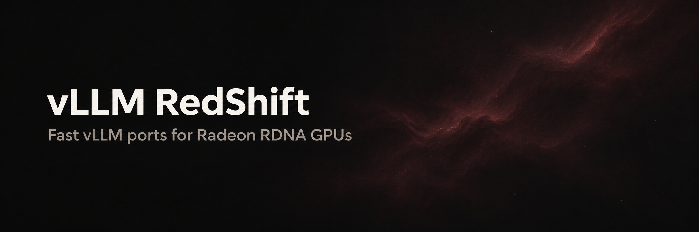
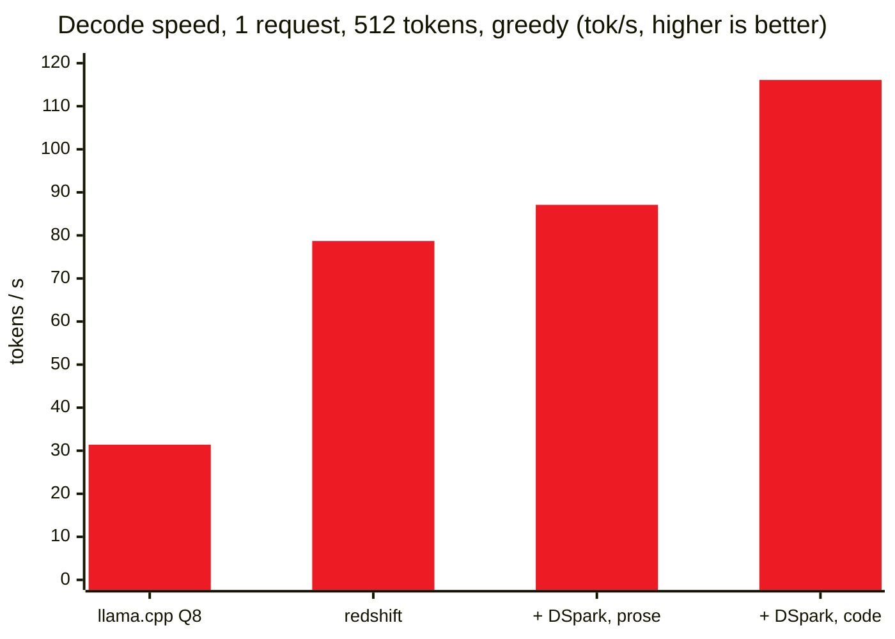
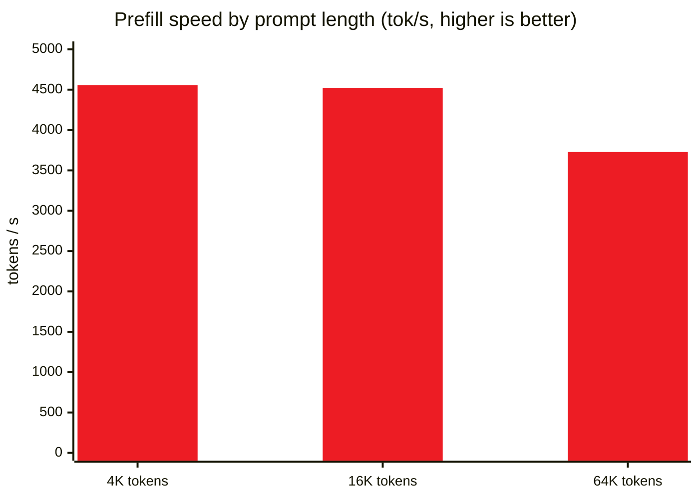

# vllm-redshift

<p align="center">
  
</p>

<p align="center">
  
  
  
  
  
</p>

**Run new frontier open models on a single AMD Radeon GPU, at full context, with the weights exactly as released.**

Upstream vLLM often supports a new model only on NVIDIA or AMD datacenter GPUs on day one. vllm-redshift adds what a
consumer Radeon card (gfx1201, RDNA4, 32 GB) is missing, one model at a time, as a small patch series on top of a
pinned upstream vLLM, and ships it as a Docker image with an OpenAI-compatible server.

## Inkling-2-Mini at a glance

| | |
|---|---|
| **Model** | [`thinkingmachines/Inkling-2-Mini`](https://huggingface.co/thinkingmachines/Inkling-2-Mini): 26B total / 3.5B active MoE, text + images |
| **Weights** | as shipped: NVFP4 + MXFP8 experts, BF16 for the rest (20 GB, not requantized) |
| **Context** | **196,608 tokens**, 2 requests at once (416,701-token FP8 KV pool) |
| **Decode** | **~79 tok/s** plain, **86-116 tok/s** with DSpark speculative decoding (2.8-3.7x llama.cpp Q8); **86-133 tok/s** at the model's default sampling (T=1.0) |
| **Prefill** | **~4,600 tok/s** at 4K-16K tokens, 3,700 tok/s at 64K |
| **Extras** | tool calling, reasoning, up to 64 images per prompt, 0% CPU when idle |





<sub>One R9700, FP8 KV, measured through the API with `scripts/release_check.py` (temperature 0) on 2026-11-22. At the
model's default T=1.0 (1024 tokens, 6 seeds): prose 86.3, short code 102.2, 41K-token code prompt 133.3 tok/s. DSpark
gains depend on how predictable the text is: code runs fastest. llama.cpp: Unsloth UD-Q8_K_XL GGUF on ROCm 7.2.4, no drafter. Two
concurrent 191K-token "needle in a haystack" prompts: both answered correctly (v0.4.0: in one of three runs one answer
ran past the test's 600-token limit while reasoning, after quoting the right code).</sub>

## Quick start

```bash
git clone --recursive https://github.com/abhinand5/vllm-redshift && cd vllm-redshift
scripts/build-image.sh inkling2-mini     # or use a prebuilt image: IMAGE=ghcr.io/abhinand5/vllm-redshift:inkling2-mini
MODEL_DIR=~/models/Inkling-2-Mini scripts/serve.sh inkling2-mini
```
Then talk to it like any OpenAI endpoint on port 8005:
```bash
curl localhost:8005/v1/chat/completions -H content-type:application/json \
  -d '{"model":"Inkling-2-Mini","messages":[{"role":"user","content":"Hi! What can you do?"}]}'
```
Want it always on? `scripts/create-container.sh inkling2-mini` makes a container `vllm-inkling2-mini` that you (or a
model manager) can `docker start` / `docker stop`.

## What was done, and why

### Inkling-2-Mini
Upstream vLLM runs Inkling 2 only on NVIDIA Hopper/Blackwell (CUDA-only kernels) and, in an open PR, on AMD MI355X
datacenter GPUs, whose kernels rely on block-scaled matrix instructions a Radeon card does not have. So redshift keeps
the model and its weights, and replaces the math underneath:

- **4-bit and 8-bit experts on a GPU without FP4.** RDNA4 has no FP4 or block-scaled matrix units, so new Triton
  kernels decode the NVFP4 / MXFP8 weights to fp16 in registers (exactly) and multiply on the fp16/fp8 matrix cores; a
  separate GEMV handles 1-2 token decode. *Why:* lossless weights at full speed, instead of a ~30 GB requantized copy.
- **Inkling's attention, in Triton.** Relative-position bias, attention sinks and L2 clipping run in custom prefill and
  decode kernels that read an FP8 KV cache directly. *Why:* there is no FlashAttention for this on ROCm, and FP8 halves the KV.
- **Room for 196K context, twice.** A small vLLM core change keeps only the last few tokens of each convolution state
  (7.2 -> 3.9 GiB per 196K request). *Why:* two full-length requests fit in 32 GB next to the weights.
- **DSpark speculative decoding on AMD**, with adaptive verification that checks only as many drafted tokens as are
  likely to be accepted, and sampled (not argmax) drafts so it also pays off at T=1.0. *Why:* up to 1.45x faster decode
  at no quality cost.
- **Fewer, fuller GPU launches.** HIP graphs, two hardware queues on RDNA4 (38 -> 60 tok/s on its own) and fused small
  kernels (1,002 -> 762 launches per step). *Why:* with only 3.5B active parameters, launch overhead was the bottleneck.
- **Vision** through vLLM's Triton attention (upstream's path needs flash-attn, which is not available here).
- **Quiet when idle:** `ROCPROFILER_REGISTER_ENABLED=0` stops a ROCm runtime thread from spinning a CPU core at 100%.

Accuracy: greedy top-1 tokens agree with the Q8 GGUF in llama.cpp on 97-99% of positions; the rest are near-ties that
flip with fp32 summation order. Per-version details and numbers: [`models/inkling2-mini/CHANGELOG.md`](models/inkling2-mini/CHANGELOG.md).

## How the repo works

Upstream vLLM is a pinned git submodule (`vllm/`, never edited). Each model directory names the upstream commit it
targets and a patch series on top, so models can sit on different vLLM versions and a rebase is "bump the commit,
refresh the patches".

```
models/<model>/model.env       VERSION, VLLM_COMMIT, PATCHES, image tag, serve flags
models/<model>/patches/        upstream/ open upstream PRs the model needs (dropped as they merge)
                               core/     small generic vLLM fixes, one per patch
                               model/    the model's AMD backend + its tests
models/<model>/CHANGELOG.md    what changed per version, with numbers
docker/Dockerfile.rocm-gfx1201 pip ROCm 10.0 (TheRock) + torch 2.13 + Triton 3.8, no system ROCm needed
results/<model>/*.json         numbers from each release check
```

<details>
<summary><b>Scripts</b></summary>

| script | what it does |
|---|---|
| `scripts/prepare.sh <model>` | `build/<model>/src` = vllm@VLLM_COMMIT + patches |
| `scripts/build-image.sh <model>` | Docker image (builds vLLM's C++/Rust for gfx1201; 30-60 min, `MAX_JOBS=6`) |
| `scripts/serve.sh <model>` | OpenAI server in Docker on `127.0.0.1:$PORT` |
| `scripts/create-container.sh <model>` | persistent container `vllm-<model>` for `docker start/stop` managers |
| `scripts/serve-native.sh <model>` | same without Docker, from an existing pip-ROCm venv |
| `scripts/export-series.sh <model> <clone> <branch>` | re-cut the patches from a dev branch; proves they rebuild it byte for byte |
| `scripts/release-check.sh <model>` | serve the image, measure it, print it next to the previous run (reports only) |
| `scripts/build-context.sh <model>` | Docker build context, shared by `build-image.sh` and CI |

</details>

<details>
<summary><b>Development and release workflow</b></summary>

Development happens on a branch in a full vLLM clone (no fork or remote needed). To ship:
1. `scripts/export-series.sh <model> <clone> <branch>`: writes the patches, fails if a changed path is not covered by
   `series.conf`, and proves `VLLM_COMMIT + series` is byte-identical to the branch.
2. `scripts/build-image.sh <model>`, then `scripts/release-check.sh <model>`: prints this build next to the previous one.
3. Decide, commit, push. The check never blocks a release.
4. To publish: bump `VERSION` + `CHANGELOG.md`, commit, push the tag `<model>/vX.Y.Z`; CI builds and pushes to GHCR
   (it refuses a tag that does not match `VERSION` or has no changelog entry):
   ```bash
   git tag inkling2-mini/v0.2.0 && git push origin inkling2-mini/v0.2.0
   ```

Each model has its own semver: MAJOR = incompatible serve flags/defaults, API behaviour or weights; MINOR = new vLLM
base or new optimizations; PATCH = fixes only (0.x while the port is still moving). Image tags:
`ghcr.io/abhinand5/vllm-redshift:<model>-vX.Y.Z`, `:<model>-vX.Y` (latest patch), `:<model>` (latest release),
`:<model>-<vllm commit>`. A manual CI run publishes only `:<model>-dev-<sha>`; pushing to `main` never publishes.

Updating vLLM: in the vLLM clone, rebase the model branch onto the new upstream commit (drop `upstream/` patches whose
PR has merged), set `VLLM_COMMIT` and the revisions in `series.conf`, then `scripts/export-series.sh` and rebuild.

</details>

<details>
<summary><b>Settings and tips</b></summary>

- Env overrides: `MAX_MODEL_LEN` (196608), `PORT` (8005), `KV_CACHE_BYTES` (8.5 GiB: one 196K request needs 3.9 GiB
  with DSpark, so two fit), `SPEC_ARGS=` (empty: no DSpark, ~78 tok/s, frees the draft's memory). Extra args go to
  `vllm serve`. DSpark supports only `num_speculative_tokens` 7 (the checkpoint's block size is 8).
- The KV budget is explicit because vLLM's automatic sizing keeps a fixed 3 GiB ROCm margin (it would offer 6.97 GiB,
  too little for 196K).
- Images: up to 64 per prompt. Agents resend their history, so the cap counts every image in a session.
- Never use a system ROCm 10.1 HIP runtime (it segfaults in `hipStreamCreateWithFlags`); the image ships its own.
- Set `HIP_VISIBLE_DEVICES=0` when an integrated GPU is present.
- Native (no Docker): a venv with torch 2.13+rocm10.0, Triton 3.8 and a vLLM build of the same commit + patches:
  `VENV=/path/.venv-rocm SO_DIR=/path/vllm-build/vllm scripts/serve-native.sh inkling2-mini`.

</details>
